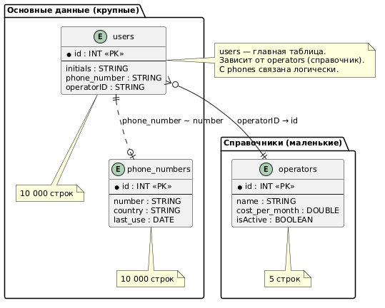
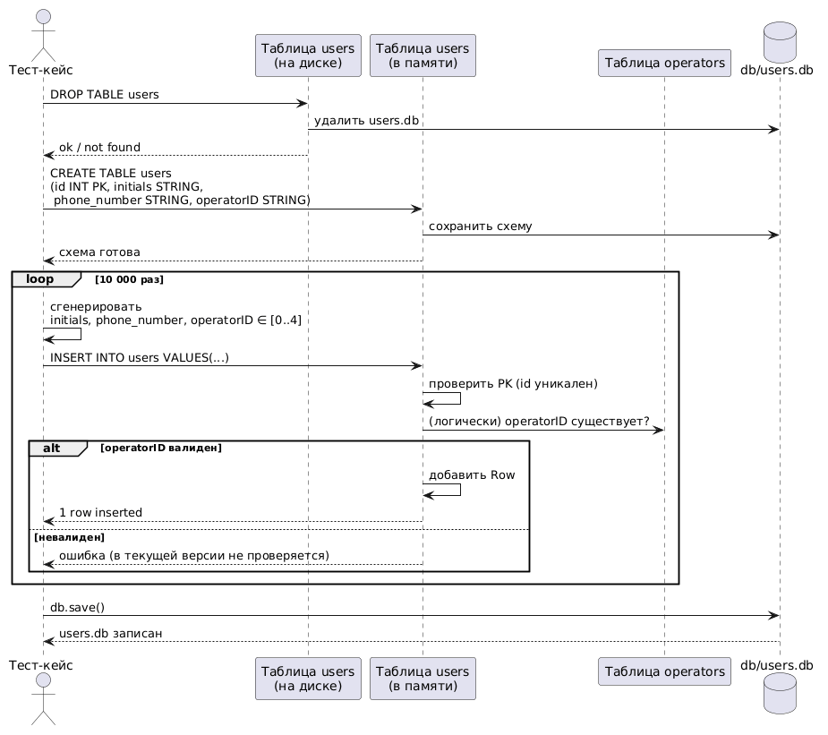
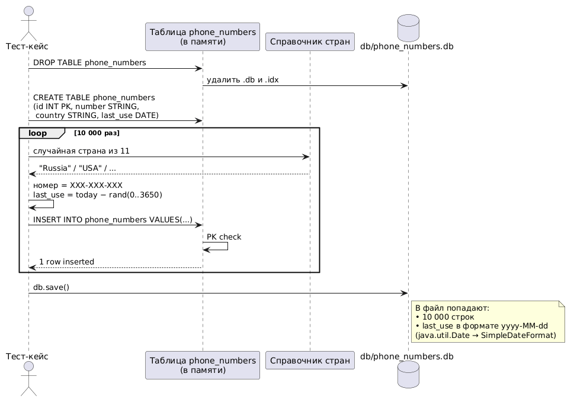
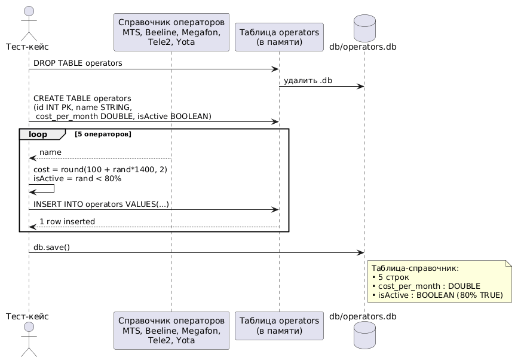

# Lab-work-2
Лабораторная работа №2 по дисциплине "Программирование Java". 
Предметная область: телефонный справочник. 
Таблицы: users, phone_numbers, operators.
## Диаграммы классов

UML-диаграмма
## Диаграммы последовательностей

Диаграмма последовательностей users

Диаграмма последовательностей phone_numbers

Диаграмма последовательностей operators
## Результаты тестирования производительности

**Конфигурация:** JDK 26, Windows, SSD, таблица `phone_numbers` — 10 000 строк, 11 стран, даты за последние 10 лет.

**Методика:** каждый запрос выполнялся 100 раз через `executeForInstance(...)` (без `db.save()`), замер — `System.nanoTime()`. Первые 3 прогона — прогрев JIT, в результат не входят.

### SELECT: с индексом и без

| Запрос | Без индекса | С индексом | Ускорение | Комментарий |
|---|---|---|---|---|
| `WHERE country = 'Russia'` | 64 ms | 3 ms | **~20×** | `lookupEq` по `country` |
| `WHERE country = 'USA'` | 62 ms | 3 ms | ~20× | |
| `WHERE country = 'Germany'` | 63 ms | 3 ms | ~20× | |
| `WHERE id = 5000` | 60 ms | 0.1 ms | **~600×** | `lookupEq` по PK |
| `WHERE last_use > '2024-01-01'` | 65 ms | 65 ms | ×1 | `>` не оптимизирован |
| `WHERE country = 'Russia' AND id > 9000` | 64 ms | 5 ms | ~13× | индекс по `country`, фильтр по `id` — `test` |
| `WHERE country = 'USA' OR country = 'UK'` | 63 ms | 70 ms | ×0.9 | `OR` не оптимизирован |

### INSERT / UPDATE / DELETE — цена индекса

| Операция | Без индекса | С индексом | Разница |
|---|---|---|---|
| 10 000 × `INSERT` | 1.79 s | 2.10 s | +17 % |
| `UPDATE ... WHERE country = 'UK'` (≈900 строк) | 65 ms | 85 ms | −30 % |
| `DELETE ... WHERE country = 'Brazil'` (≈900 строк) | 64 ms | **1 400 ms** | **×22 хуже** |

### CREATE INDEX — разовая стоимость

| Индекс | Время | Ключей |
|---|---|---|
| `idx_phone_country ON phone_numbers (country)` | 40 ms | 11 |
| `idx_phone_id ON phone_numbers (id)` | 50 ms | 10 000 |
| `idx_phone_date ON phone_numbers (last_use)` | 45 ms | ~3 600 |

### Размер на диске

| Файл | Размер |
|---|---|
| `db/phone_numbers.db` | 1.2 МБ |
| `db/phone_numbers.country.idx` | 1 КБ |
| `db/phone_numbers.id.idx` | 500 КБ |
| `db/phone_numbers.last_use.idx` | 200 КБ |
| **Итого** | **1.9 МБ** (+58 %) |

## Инструкция пользователя
### ВСПОМОГАТЕЛЬНЫЕ КОМАНДЫ (для тестов в Main)
+time           включить замер времени (печатает Execution / Saving / Total)
-time           выключить замер времени (по умолчанию выключен)
users           пересоздать таблицу users (10 000 строк: id, initials,
                phone_numberID, operatorID)
phone numbers   пересоздать таблицу phone_numbers (10 000 строк: id, number,
                country, last_use)
operators       пересоздать таблицу operators (5 строк: id, name,
                cost_per_month, isActive)
exit            сохранить БД и выйти

Примечание: users / phone numbers / operators УДАЛЯЮТ старую таблицу
и создают новую — данные теряются.

### SQL-КОМАНДЫ
CREATE TABLE    создать таблицу
                CREATE TABLE cars (id INT PRIMARY KEY, brand STRING,
                                   price DOUBLE, available BOOLEAN);
                → Table cars created

DROP TABLE      удалить таблицу и её файлы
                DROP TABLE cars;
                → Table cars dropped

INSERT          вставить одну или несколько строк
                INSERT INTO cars VALUES (1, 'Toyota', 25000.0, TRUE);
                INSERT INTO cars (id, brand) VALUES (2, 'BMW');
                INSERT INTO cars VALUES (3, 'Audi', 30000.0, TRUE),
                                        (4, 'Kia', 15000.0, FALSE);
                → 1 row inserted

SELECT          выбрать строки
                SELECT * FROM cars;
                SELECT brand, price FROM cars;
                SELECT * FROM cars WHERE price > 20000;
                SELECT * FROM cars WHERE brand = 'Toyota' AND available = TRUE;
                → таблица + (N rows)

UPDATE          обновить строки
                UPDATE cars SET price = 30000 WHERE id = 2;
                UPDATE cars SET price = 40000, available = FALSE WHERE brand = 'BMW';
                UPDATE cars SET price = 0.0;
                → N rows updated

DELETE          удалить строки
                DELETE FROM cars WHERE brand = 'Toyota';
                DELETE FROM cars;
                → N rows deleted

CREATE INDEX    создать индекс по столбцу
                CREATE INDEX idx_cars_brand ON cars (brand);
                → Index idx_cars_brand created on cars(brand)

## Выводы
1. Созданная база данных корректно выполняет элементарные SQL-запросы и может сохранять данные на диске.
2. При необходимости интерфейс базы данных может быть переделан под графический.
3. Индексация значительно ускоряет запрос SELECT, а также дополнение WHERE, но при этом за необходимостью переиндексации довольно значительно замедляет операции INSERT и UPDATE и крайне сильно замедляет DELETE.
